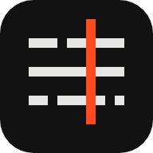

# Stave 镜谱 — an AI film studio on self-hosted MiniMax H3

A stave is the set of lines music is written on; Stave lays a film out the
same way, on one score: every shot, take and cut in its place, read top to
bottom at any moment. 镜谱 is its Chinese name, a score of shots. The name,
the mark and how to use them: [docs/brand.md](docs/brand.md).

A film-crew workflow in the browser: **script → elements → shotlist → hero
frames → takes → timeline → export**. The director is your own subscription
Claude or Grok, connected over MCP. Video renders on **MiniMax H3-Base** running
on your RunPod endpoint. Hero frames and element references are uploaded (a
still-image backend is a TODO). Everything is stored in R2 and a small
SQLite/D1 database. Deploys to Cloudflare Workers.

Design: [docs/cinema-studio-h3-design.md](docs/cinema-studio-h3-design.md).

---

## How it fits together

```
 Claude / Grok (your subscription) ──MCP + OAuth──►  /mcp
                                                       │
 Browser (Cloudflare Access) ─────────REST───────────►  Studio (Next.js on Workers)
                                                       │  compiler · checkpoints · budget · orchestrator
                           ┌───────────────────────────┼───────────────────────────┐
                           ▼                           ▼                           ▼
                 RunPod H3 worker              RunPod assembler            Uploads (R2)
                 (ComfyUI, 768p + audio)       (ffmpeg, CPU)               (hero frames, refs, music)
                           └──────────── writes to R2 ◄────────────────────────────┘
```

- **One shot = one H3 request.** A shot is structured data (beats, camera,
  dialogue, sound, references); the compiler turns it into an H3 prompt in the
  community-documented format, with the project Look on every shot. Four modes:
  `text`, `keyframe` (hero frame, optional end frame), `reference` (≤3 refs),
  `edit` (revise a take).
- **Two human checkpoints.** The latest script and the shotlist must be
  approved on the web before anything renders. Approval is web-only; the agent
  gets `not_approved` and tells you which page to open.
- **Money asks first.** Every paid tool returns an estimate and `needs_confirm`
  until called with `confirm: true`; projects have a budget cap.
- **The GPU is a pod you can see.** The studio creates one RunPod pod from
  your ComfyUI image, restricted to an allow-list of GPU types, starts it on
  the first render, shows status/uptime/cost in the rail, and stops it after
  idling. "暂时没资源" when none of the allowed GPUs has capacity.
- **Every take is a data point.** Completed takes record their GPU type,
  hourly price and output seconds; the Machine page ranks GPU types by USD
  per second of video, estimates switch to measured speed, and
  `RUNPOD_GPU_PRIORITY=cost` orders the allow-list by that ledger.
- **LoRAs are a library.** `/loras` holds speed and style LoRAs with their
  HuggingFace links; projects pick defaults in the Look, shots can override,
  and the pod downloads a missing file before rendering.
- **The director has three tiers.** `start_film` takes the brief and the
  running time and returns the plan: Tier 2 is an edit grammar (cut,
  continuous, bridge, insert/return, shot/reverse, match cut, jump cut,
  montage) the compiler executes by feeding anchor frames to the right H3
  workflow; Tier 3 is a cinematography vocabulary (framing, lens, light,
  grade, texture, VFX, animation style, pace) validated by the schema and
  rendered into the prompt. `agent/editing.md` and `agent/cinematography.md`
  are generated from the catalogs.
- **Errors stop before the spend.** Each shot is staged in screen terms
  (blocking, what moves, composition on the 38/62 lines, first and last
  frame written before they are drawn), each scene has a colour script, and
  a colour-block storyboard is drawn from the shotlist before any frame.
  A fresh reviewer reads the story, every shot before it renders and the
  cut (`review_packet` → `record_review`); `generate_take` warns until the
  exact prompt and frames passed, and refuses to blindly re-render a
  rejected input inside the spend envelope the user grants on the web. The
  lint flags the pictures AI video gets wrong; the batch renders the most
  fragile shots first; a retro counts what went wrong for the next film.
- **Pictures before takes, with the model the user picks.** With the
  per-project switch on (the project's Director page → *Allow image
  generation by agent*), character sheets, first and last frames, region edits and style
  frames are drawn with the project's image model — the same models as
  Canvas. GPT Image (Codex on the user's ChatGPT plan, device-code login
  from the Machine page, or the images API) and Qwen-Image 3.0 Pro (API) are
  drawn by a **painter** — `workers/painter`, a small always-on machine (a
  RunPod CPU pod, a VPS) that claims image jobs from the Studio — so those
  pictures are ready before the GPU pod starts; MiniMax H3 Image (the open
  weights, self-hosted) draws on the
  GPU pod while it runs, with the LoRAs the user picks for it there (each
  card's settings applied; an 18+ LoRA needs 18+ on and draws only from
  pictures the Studio drew or the reference library, never from an upload or
  an imported picture). With *Agent use Canvas* on, the director may also
  compose a character's look from the Canvas library (`compose_character`)
  when it judges one is needed, with the same model. A picture takes the
  model's settings, at most its number of reference pictures (the prompt
  names only those), and its way of naming them (`<Picture N>` for MiniMax H3 Image). Buttons on every page and
  the director (following a picture plan: reuse, crop, edit, then draw) queue
  them. Each picture comes back with pixel checks and a Codex self-check
  (a blocker is redrawn once with the findings), then a fresh reviewer's
  coded rubric decides before a take is built on it.
- **Pictures have names.** Every picture has a handle (`IMG-12`) and a name,
  so "redraw IMG-12" means one picture; the Pictures page lists them all with
  where each is used, and any grid deletes a batch.
- **Fix a take without rerolling it (Viggle Remake).** Paint one or two
  frames right, say what changes, and the take is re-shot with its motion,
  camera, timing and sound kept: props, wardrobe, faces, backgrounds.
- **The agent calls us.** No LLM API keys anywhere: the studio is a remote MCP
  server with its own OAuth 2.1, so Claude's and Grok's custom connectors can
  attach. `agent/director.md` is the director guide, served as a tool and a
  resource and pasteable into your chat client.

## Private projects

A project is **shared** (every signed-in user sees it — the default, and how
every project before this one behaves) or **private** (only the user who made
it). Choose on the Projects page when you create it, or later under Settings
→ Sharing (the owner only, on the web; the director can create a private
project — `create_project` / `start_film` take `visibility` — but never makes
one public). The account is the Cloudflare Access email, and an OAuth
connector acts as the user who approved it, so each user's Claude or Grok sees
that user's private projects and nobody else's.

- **One rule, enforced at the door.** Everything in a project hangs off its
  `project_id`. Every web route (path, query and JSON body) and every MCP
  tool (its arguments) is checked by `src/auth/scope.ts`: any Studio id in it
  (`prj_`, `sht_`, `tke_`, `ast_`, `ele_`… by prefix, wherever it sits) that
  belongs to someone else's private project answers `not_found`, the same as
  an id that does not exist. New routes and tools are covered without being
  listed; `tests/private-projects.test.ts` fails if a table or id prefix is
  added that the guard does not know.
- **What is private stays private.** Copying an element out of a private
  project (to the library or another project) gives the copy pictures and a
  voice card of its own; a shot, element or voice card elsewhere cannot point
  at a private project's picture, audio or voice card. When a shared project
  turns private, what the library and other projects took from it while it
  was shared gets copies of its own there, so it keeps working for everyone
  else (the decision log says how many).
- **The machines stay shared.** The GPU pod, the painters, the libraries
  (LoRAs, styles, Canvas references) and the API keys serve every project.
  Others see that the pod is busy, never with what. Stopping the pod while it
  works for someone else's project asks first (`needs_confirm`); terminating,
  adopting or repairing it, and the painters' controls and Codex login, are
  for `ADMIN_USERS` (every signed-in user when unset, as before).
- **Projects from before** have no owner and stay shared; an admin makes one
  private and becomes its owner.
- **Limits.** Picture and video links (`/media/…`) are unguessable but not
  signed: whoever is given one can open it. `MCP_STATIC_TOKEN` acts as
  `MCP_STATIC_USER` (unset: nobody, shared projects only). With
  `AUTH_MODE=dev` everyone is `DEV_USER`, so private means nothing there.

## Run it locally

```bash
pnpm install
cp .env.example .env.local   # AUTH_MODE=dev is enough to click around
pnpm dev                     # http://localhost:3000
```

Without RunPod / R2 keys the studio still lets you build a project,
script, elements, shotlist and compile prompts; generation buttons report what
is missing. Tests:

```bash
pnpm test        # vitest: pipeline, compiler, checkpoints, OAuth, assembler input
pnpm typecheck
```

Connect Claude Code during development with a static token:

```bash
MCP_STATIC_TOKEN=devtoken pnpm dev
claude mcp add --transport http studio http://localhost:3000/mcp --header "Authorization: Bearer devtoken"
```

## Deploy

### 1. RunPod (pod mode)

- Build `workers/h3-runpod/Dockerfile.pod` on top of your ComfyUI image
  (custom nodes and LoRAs baked in; the big H3 weights on a network volume)
  and push it; set `RUNPOD_POD_IMAGE`, `RUNPOD_NETWORK_VOLUME_ID`,
  `RUNPOD_GPU_TYPES` and `STUDIO_WORKER_TOKEN`. The pod runs
  `workers/h3-runpod/server.py`, a small job server that renders with the
  H3 graphs (`workers/h3-runpod/handler.py`) and assembles exports with
  ffmpeg (`workers/assembler/handler.py`), uploads to R2 and calls the
  studio's signed webhook.
- Drop the T2VA / I2VA / FL2VA / R2VA API-format workflows into
  `workers/h3-runpod/workflows/` and fill `mapping.json`.
- If the model volume is a *global* network volume, the REST API cannot
  attach it yet. Create the first pod in the RunPod console with the values
  from Machine → "Adopt a pod created by hand", then adopt
  it by id; the studio runs it but never terminates or replaces it.
- Serverless endpoints (`RUNPOD_MODE=serverless`) are still supported in
  code but are a TODO, not the default.
- Pick a data-center region that the MiniMax Community License allows (it
  excludes the US, EU, UK and South Korea). That is the deployer's
  responsibility; see the design doc §2.3 and §10.

### 2. Cloudflare

```bash
wrangler d1 create studio            # put the id into wrangler.jsonc
wrangler r2 bucket create studio     # served by the app at /media/* (R2_PUBLIC_BASE_URL=https://<studio>/media)
pnpm db:emit                         # writes migrations/*.sql from src/db/migrations
wrangler d1 migrations apply studio --remote
wrangler secret put RUNPOD_API_KEY   # and the rest listed in wrangler.jsonc
npx opennextjs-cloudflare build && npx opennextjs-cloudflare deploy
cd workers/cron && wrangler deploy   # minute-by-minute sweep → /api/cron/sweep
```

Put the studio hostname behind **Cloudflare Access** (set `AUTH_MODE=access`,
`CF_ACCESS_TEAM_DOMAIN`, `CF_ACCESS_AUD`) and add bypass rules for `/mcp`,
`/.well-known/*`, `/api/oauth/*`, `/api/runpod/hook`, `/api/assembler/hook`,
`/api/cron/sweep`, `/api/painter/*`, `/api/pod/*` and `/media/*` (unguessable
keys), which carry their own auth (OAuth bearer, HMAC, secret, token). `AUTH_MODE` fails closed: anything but
`dev` means Access.

### 3. A painter (pictures, off the GPU)

Set the Worker secret `PAINTER_TOKEN` (or reuse `STUDIO_WORKER_TOKEN`), then on
any small always-on Linux machine:

```bash
export STUDIO_URL=https://<studio> PAINTER_TOKEN=<the secret>
mkdir -p ~/cinema-painter && curl -fsSL "$STUDIO_URL/api/pod/bundle?token=$PAINTER_TOKEN" | tar xz -C ~/cinema-painter
bash ~/cinema-painter/h3-runpod/run_painter.sh
```

or `docker build -t cinema-painter workers/painter` and run it with a volume
on `/data`. It appears on the Machine page; log Codex in there once. See
`workers/painter/README.md`.

### 4. Connect the director

- **Claude**: Settings → Connectors → Add custom connector →
  `https://<studio>/mcp`. The OAuth consent page is the studio itself.
- **Grok**: grok.com → Connectors → New → Custom → same URL.
- Paste `agent/director.md` into the project instructions, or let the agent
  call `get_director_guide` first.

## Layout

```
agent/director.md        the director guide (source of truth; emitted to src/mcp/guide.ts)
agent/editing.md         Tier 2 edit grammar (generated from src/studio/editing.ts)
agent/cinematography.md  Tier 3 vocabulary (generated from src/studio/cinematography.ts)
docs/                    design document
migrations/              SQL emitted for wrangler d1 (pnpm db:emit)
src/app/                 pages (/, /p/[id]/…, /canvas, /library, /machine, /connect, /oauth/authorize) and /api routes
src/studio/              schemas · types · repo · compiler · checkpoints · cost · orchestrator · backends · storage
src/mcp/                 MCP server (tools + resource)
src/oauth/               OAuth 2.1 authorization server for connectors
src/auth/                Cloudflare Access JWT, bearer tokens, HMAC
src/db/                  SQLite (Node) / D1 (Workers) and migrations
src/studio-ui/           the studio pages' components and styles
workers/h3-runpod/       ComfyUI handler for H3 and the pod's job server
workers/painter/         the painter: draws pictures (Codex / images API), crops, extracts frames
workers/assembler/       ffmpeg serverless handler
workers/cron/            scheduled Worker that triggers the sweep
src/studio/gpu.ts        pod lifecycle: create on the allow-list, start/stop, auto-stop, replace, per-GPU stats
tests/                   vitest
```

## API

`src/app/api/**` implements the endpoint list of the design doc §7.2. Every
error is `{ error: { code, message, details } }` with the codes `validation`,
`unauthorized`, `forbidden`, `not_found`, `not_approved`, `needs_confirm`,
`budget_exceeded`, `backend_error`. MCP tools are the same operations with the
same zod schemas (`src/studio/schemas.ts`).

## What is measured, not assumed

The cost model (`RUNPOD_SECONDS_PER_OUTPUT_SECOND`, `RUNPOD_GPU_USD_PER_SECOND`)
and the prompt rules in `agent/director.md` carry placeholders until the P0
measurements in the design doc §9 are done on your endpoint. The settings page
has an eval mode for blind A/B scoring of takes.

## Regenerate 2K

NVIDIA's open Open-H3-Regenerate-2K replaces MiniMax's API-only
high-resolution stage: a completed 768p take is re-generated at 1080p / 2K /
4K in three refine steps on the pod (Board button or `regenerate_take`), the
file sits beside the take, and the `master-upscaled` export uses it. The pod
installs the node packs and downloads the ~21 GB of weights at boot
(`REGEN_2K=1`).

## The pages

Top bar on every surface (project crumb, GPU pill, EN / 中, Projects / Canvas /
Library / Machine / Connect). Inside a project there is no side rail: under the
top bar sit the stages as one row of words — **Score**, Brief & style, Script,
Elements, Board, Pictures, **Cut**, **Director** — the budget, and *the line*:
the whole film to scale, one segment a shot (a gap is a cut, a dotted join is
continuous, red is where you are), each linking to that shot.

- **Score** (`/p/:id`, the project's home): one time axis with the film's
  layers as staves — scenes, script, the board's frames, every take as a pip
  (circled = in the cut, NG = failed), sound, the cut, what the lint found at
  the second it is about, and what each shot cost. Above it, *Needs you*: the
  approvals, reviews and choices that are the person's, and one red button for
  the next step. Below it, the shot under the playhead.
- **Brief & style**, **Elements**: as before.
- **Script**: versions and approval; a version can be read, **lined** or
  compared with the version before it. Lined is a lined script: each shot names
  the script lines it shows (`scriptLines`, quoted from the script), drawn as a
  tramline in the margin with its slate; a clause no shot shows is underlined,
  and a sentence can be lined to a shot or taken off one in place. Sections sit
  next to their scenes, with the time each heading states against the board's
  seconds. `lint_project` flags `script.uncovered` and `script.quote.stale`.
- **Board**: shot cards with slates (2·3), cinematography codes, link and lint
  badges; the shot drawer, whose shot and tab are in the address
  (`?shot=…&tab=…`). The buttons that spend show their estimate; takes that
  failed for one reason are one NG row.
- **Screening** (`/p/:id/screening`, lights down): a shot's takes side by
  side, played in step; score, faults, save, and on to the next circled take
  without a review. All by keyboard: 1–5, Ctrl/⌘+Enter, Space, C, ←/→, ↑/↓,
  Enter, N.
- **Pictures**: every picture by handle; filters (awaiting review, listed
  twice, …) and the open picture are in the address; Pass / Fail with what is
  wrong is recorded as a frame review.
- **Cut** (`/p/:id/timeline`): tracks on one time axis (titles, picture, the
  takes' sound, narration, music, silences); drag a clip to move it, an edge to
  trim it, Ctrl/⌘+Z to undo; J/L-cut, held frame, speed, repeat, mute per clip;
  the seams of continuous joins and a one-step fix; export, and the
  full-resolution pass of every pick (what Finals was).
- **Director** (`/p/:id/director`): *Needs you* in full, every check in one
  list, and what the director may do — image and voice permissions, the spend
  envelope, delegated approval, requirements (the user can add one), decisions,
  reviews.
- **Settings**: name, budget cap, sharing, delete.

Deleting a shot, a scene, an element, pictures or a project keeps what was
removed in a trash for 14 days (migration 0024): the web answers with an Undo
notice, the Director page (and the Projects page, for whole projects) lists
what can still be put back, and a restore writes the same rows back, re-attaches
pictures where they were used and, when nothing changed in between, approves
the shotlist again. Picture files are removed from storage only when the entry
expires (the sweep).

The interface is in English or Chinese (EN / 中 in the top bar, per browser);
text the server writes — lint messages, errors — stays in English.

Global pages: Canvas (compose a character from the reference library, below),
Library (styles + LoRAs), Machine (the pod), Connect (MCP). The look is
"Score": a neutral grey card with ink on it, a dark room for Screening, square
corners, Archivo and IBM Plex Mono (self-hosted, SIL OFL), and one tally red
that means only *here*, *rolling* and *the next step*.

## Director layer (`packages/director`)

Judgement helpers that sit beside the Studio's own tools. **They are served
from the Studio MCP connector** (`list_styles`, `suggest_styles`, `get_style`,
`compile_look`, `apply_style`, `lint_shotlist`, `validate_treatment`,
`check_cue_map`, `cut_on_beats`, `check_subtitles`, `plan_batch`,
`check_timeline`, `fork_style` / `save_style` / `delete_style` for a style of
the user's own, and `get_director_guide` sections `judgement` / `technique` /
`styles`), so Grok and Claude get them through the same connector; the package
also runs as a local stdio MCP for the two tools that need a machine
(`assemble_local` with ffmpeg, `synthesize_narration` with edge-tts). What it
adds: 16 style presets (eleven-section
`STYLE.md` convention) compiled into Studio fields, a treatment validator, a
rhythm lint for shotlists, a cue map that snaps cuts to the beat, a timeline
check (J/L cuts, fades, titles, narration, silences) whose output the Studio's
assembler renders, subtitle reading-time rules and a batch planner. Registered in
`.mcp.json` as `director`; see [`packages/director/README.md`](packages/director/README.md).

```bash
pnpm --filter @stave/director build
pnpm --filter @stave/director test
```

## Voices: voice cards and dialogue

A character's voice is a **voice card**, a pre-production asset like the
character sheet. A card is one identity with states (an age, a hoarse or
disguised register), each with an English description that goes verbatim into
the prompt and dry reference audio (10–15 s). Cards live in a **global
library** shared by every project, like the LoRA library, or in one project.
A character points at a card (`voiceCardId`) and picks its default state
(`voiceState`), so an edit to the card reaches every project that uses it.
MCP: `list_voice_cards`, `get_voice_card`, `create_voice_card`,
`update_voice_card`; `create_element` / `update_element` take `voiceCardId`
and `voiceState`. Reference audio must be synthetic, licensed or from a
consenting performer, and the card's `source` records which. There is no web
panel for cards yet.

**Dialogue** compiles to the format of MiniMax's H3 prompting guide:
`<speaker> (S1), <voice description>, says (<delivery>): <d>[Chinese] <the
line verbatim></d>`, with the description where a speaker first speaks and a
timed line (`startS` / `endS`) placed in its beat's `[Shot k]`. Lines without
a language use the project's `look.dialogueLanguage` (default `zh`; set `en`
on an English project). A line's `kind` is `onscreen` (default), `offscreen`
or `inner`: only on-screen lines go into the prompt, since the model makes
whoever is in frame mouth any line it hears about; with only off-screen or
inner lines the prompt says every mouth stays closed. The compiler warns about
a line across a hard cut, past the end of the shot, or more lines than the
shot holds (about 4 Chinese characters a second, 3 when weak or hoarse).

Two prompt experiments, off by default and recorded on the take:

- `voiceRefs` (R2VA): each on-screen speaker's reference audio becomes
  `<Audio j> is the voice-timbre reference for <Subject k> (S1).`; the worker
  cuts it to about the line's length as 48 kHz stereo, within the model card's
  limits (3 clips, 2–15 s each, 15 s in all).
- `audioFirst` (I2VA): a line's prepared audio (`audioAssetId`) is anchored at
  its start frame with `MiniMaxH3AddGuide` (`workflows/I2VA_GUIDE.json`), so
  the picture follows a given voice.

**The voice API.** With *Allow voice API use by agent* on (the project's
Director page, web only) the director makes and uses voices through
TokenSail's audio endpoints, with the Worker's `TOKENSAIL_API_KEY` (the key the
face check and Qwen-Image already use). The user picks the TTS model there
(Qwen Audio 3.0 TTS Plus by default; Flash; CosyVoice 3.5 Plus / Flash) and a
character budget, since speech is billed per character.

- `create_api_voice` makes a voice from a card state, bound to one model:
  `clone` uploads the state's reference audio (every model); `design` sends
  its description (CosyVoice 3.5 only). The `tv_` id is kept on the state. An
  account holds 10 such voices by default; `delete_api_voice` frees one.
- `speak` says text with a state's voice and keeps the audio as an asset:
  off-screen lines, inner monologue, a line prepared for `audioFirst`, audition
  samples. `voice_status` shows the switch, the model and the budget left.
- `transcribe_audio` (qwen-audio-3.0-asr-flash) turns audio back into text and,
  given the intended line, the character error rate: the pronunciation check.

Not in the Studio yet: separating and re-voicing finished takes (TokenSail has
no voice-conversion endpoint), and the consistency check before export.

## Canvas: the reference library

`/canvas` composes one character picture from a **portrait** (face, hair), a
**costume** and a **pose** — picked from a library of 1,439 pose pictures
(grey mannequins, 288 poses × 5 camera angles, line art or depth map), 3,224
costumes (ギア photo-real and anime, CharaDB, Shisei Chinese historical) and
1,499 portraits (AI-generated adults), or uploaded — plus more pictures up
to what the model takes. The pose can be flipped left to right (*⇋ 镜像*;
the painter mirrors the picture before drawing, and the prompt says so). The
prompt is composed for you (each picture named by its place and
given one job, ported from anhao/ai-pose-gallery-zh) and can be edited. It
comes in two languages (*Prompt language*): the Chinese original, and an
English template that says the same recipe clause for clause
(`src/studio/canvas-prompt.ts`, every style line included) — the default
follows the model (`promptLang` in `models.ts`: English for MiniMax H3
Image, Chinese for the others) and either can be picked for any model. The
pictures are named as the model reads them in both (图1 / `Picture 1`,
`<image1>`, `<Picture 1>`); an English prompt leaves the library's Chinese
names (poses, outfits, hairstyles) to the pictures, and what you type — the
description, the note, the people's names — goes in as typed. GPT
Image draws it on a painter into a project (`IMG-n`, recipe in
`meta.canvas`), optionally straight onto an element as a reference view.
The director gets the same library through `list_references`,
`get_reference` and `compose_character`.

- **Your own pictures.** A face, an outfit and a pose can be uploaded; an
  uploaded pose says what it is (照片 a photo — only the pose is taken, 白模
  a mannequin or line art, 深度 a depth map). A project character can stand
  in for the portrait (its sheet is the face and, without a costume, the
  outfit).
- **我的 (your own pictures).** The library's **Mine** tab uploads a
  portrait, a costume or a pose (照片 / 白模 / 深度) with a name and tags into
  the signed-in user's own library (`user_references`, R2): it shows in every
  project, first in the Portraits / Costumes / Poses tabs under 我的, with
  search, filters and random, and can be renamed, retagged or deleted. A
  portrait gets the face check (模拟 / 真实); a costume or a pose gets none
  and counts as 模拟. The agent sees them through `list_references`.
- **Text to image (文生图).** Switch the recipe to *文生图 · Text* and
  describe the picture: no reference is needed, and the style, size, model
  and LoRAs still apply (GPT Image, Qwen-Image 3.0 Pro, MiniMax H3 Image).
- **Two people (双人).** Person A and person B each get a portrait and a
  costume (or a project character), with one two-person pose — the library's
  双人 poses or an upload — and *Person A in the pose* says which figure is
  whom (left, right, front, back, top, bottom); each can be named. The
  prompt binds every picture to its person and keeps the two apart. GPT
  Image takes up to five pictures, MiniMax H3 Image ten. Character sheets
  keep the faces apart best.

- **Metadata only.** `src/studio/references-data.ts` is generated by
  `node scripts/import-references.mjs <checkout of anhao/ai-pose-gallery-zh>`.
  No picture is mirrored: thumbnails load from the galleries themselves, the
  painter downloads the three to five pictures a job uses, and "Add to
  project pictures" fetches one picture into a project. The galleries allow
  one picture at a time as a generation reference (commercial work included)
  and forbid bulk download and redistribution; CharaDB pictures are never
  used on a real person's photo or for a minor (enforced for uploaded faces);
  portraits never impersonate a real person.
- **模拟 / 真实.** Every picture is tagged **模拟** (green: AI-generated, a
  3D render, an illustration or no face — the reference of any picture, R18
  included) or **真实** (grey: it may show a real person — not for R18;
  every other picture as before). An upload or import gets its tag from a
  face check made once as it arrives — the only time a model looks: a
  vision model (TokenSail's `qwen3.8-max-0902`, or DashScope's Qwen-VL, with
  the Worker's `TOKENSAIL_API_KEY` / `DASHSCOPE_API_KEY`;
  `src/studio/face-check.ts`). A photograph, anything photorealistic, a real
  person's likeness, a minor, an unsure answer or no check is 真实 (Check
  again on the Pictures page). Library pictures are 模拟. A drawing is
  stamped as it is kept (`src/studio/provenance.ts`): text to image is
  模拟; from references, 真实 as soon as any picture it came from — a
  reference, the picture it edited, a take's pictures — is 真实. The Chinese names and tags are
  anhao's translation, whose data is not under that repository's MIT licence:
  ask its maintainer before publishing them more widely.
- **18+ is hidden by default.** Two pose systems and the lingerie / sensual
  costumes (and CharaDB's own flag) are filtered out server-side until the
  signed-in user confirms they are an adult on the Canvas page (web only,
  stored per user in `user_settings`). The director sees what its user
  unlocked and cannot unlock it.

## Models and their settings

`src/studio/models.ts` is the registry of every model the Studio runs —
GPT Image (Codex / API), Qwen-Image 3.0 Pro (API), **MiniMax H3 Image** (on the GPU pod),
MiniMax H3, Open-H3-Regenerate-2K, Viggle Remake — with the settings their
authors recommend (steps, CFG, sampler, schedule, shift), runtime, licence,
moderation and files. LoRAs carry theirs too (`loras.params_json`,
`base_model`; the seeded ones know their cards). A render resolves base model
→ workflow variant → speed LoRA → the caller's steps, so picking a model or a
speed LoRA sets everything; the Board's compile panel shows the settings and
where they came from. Library → Models lists it all; `list_models` gives it
to the director.

**MiniMax H3 Image on the GPU pod (open weights, no API).** MiniMax published
the weights of its H3 image model on 2026-11-10
([MiniMaxAI/MiniMax-H3-Image](https://huggingface.co/MiniMaxAI/MiniMax-H3-Image)):
text to image and multi-reference editing in one checkpoint, a 33B DiT (H3
without the audio layers) distilled to 6 steps without guidance. The Studio
runs it itself, in the pod's ComfyUI, not through MiniMax's API: with
`H3_IMAGE=1` (default) the pod downloads Comfy-Org's repackage right after
the H3 video set — +22 GB (int8 DiT 21 GB, image VAE 1.2 GB); the text
encoder is the MiniMax-H3 one the video graphs already load, so it is on the
pod once. The pod's painter
advertises `comfy:minimax-h3-image` and draws with
`workflows/H3_IMAGE.json` — Comfy-Org's `image_minimax_h3_image_t2i` /
`image_minimax_h3_image_edit` templates without their prompt-enhancer branch:
`MiniMaxH3ImageConditioning` (up to ten pictures, `<Picture 1>`… in the
prompt; none is text to image), the negative zeroed (the model takes no
negative prompt), KSampler 6 steps / CFG 1 / euler / simple. It needs ComfyUI
**v0.45.0**, which is now the pod's default `COMFYUI_VERSION`. The model's
working range is about 4–20 MP and it is weak below, so a Studio size
(1344×768, 1024×1536…) is drawn on a canvas of the same shape at 4 MP
(2688×1536, 1664×2496; `image_models.json` `min_area`, the job's
`resolution` 2048) and resized to the asked size, as MiniMax's own server
does (`min_generation_area`). Canvas can also deliver the picture at the
model's own resolution: *Resolution* offers 4, 9 and 16 MP beside the
Studio size — the same shape on the 32-pixel grid (16:9: 2688×1536,
4032×2304, 5376×3072; 2:3: 1664×2496, 2496×3744, 3328×4992), drawn at that
size and saved as drawn, never resized (`canvasOutputSize` in
`canvas-prompt.ts`; the painter takes sizes up to 6400 px a side and 21 MP
from a pod model, 4096 px from the others). 16 MP is what the card
recommends: several times slower and tens of MB a picture, so it is for a
picture that will be shown large, printed or cropped, not for a reference.
A reference picture over 4096 px is scaled to 4096 before it is sent to any
model, and an edit of a large picture by a model that draws small comes
back at most 4096 px on its long side (edit it with MiniMax H3 Image to
keep its pixels). Choose it per project on the Director page
(the director's sheets, frames and edits) or per picture in Canvas.
The model expects a detailed English description of the whole picture: the
director's sectioned prompts fit; MiniMax's API expands short prompts first
(H3-Image-Context-IR / MiniMax-H3-Image-PE), a step not run here, so
Canvas composes its recipe in English for this model unless Chinese is
picked. No content filter, no
Codex self-review. Licence: the MiniMax-H3-Image Community License Agreement
— **not** an open-source licence: it does not cover use in the EU, the UK,
South Korea or the US (put the pod and its users elsewhere, or ask MiniMax),
it asks for MiniMax's written authorization above 1M USD of annual revenue
or to host the model for third parties, and a commercial product must name
MiniMax-H3-Image in its interface. Not yet run on a pod from this
repository: the first picture is the test (the painter checks the graph
against the pod's ComfyUI before it queues and names what is missing).

**Qwen-Image 3.0 Pro through an API (the pose gallery's 百炼 path).**
anhao/ai-pose-gallery-zh calls `qwen-image-3.0-pro` on Alibaba Cloud Model
Studio from the browser; here the CPU painter pod calls it — no GPU, and it is
not a ComfyUI model (the weights are not published). With `TOKENSAIL_API_KEY`
it goes through TokenSail's OpenAI-style `/v1/images/generations` (`image`:
the reference URLs, `size` `WxH`); with `DASHSCOPE_API_KEY` through
DashScope's own `multimodal-generation` endpoint, exactly as the gallery
does. Same composed prompt (图1/图2/图3), up to three pictures, `watermark`
off, and Canvas offers the gallery's `prompt_extend` (off by default: it
rewrites the composed roles) and a negative prompt. The vendor fetches the
references by URL, so the painter re-hosts them in R2 (`<job>.refN.jpg`,
mirrored when asked) and the Studio deletes them when the job ends. The
picture comes back as a URL that expires in about an hour and is fetched at
once; the cost TokenSail reports is kept in the job's output. Errors say what
to do (402: top up; 403: allow the model for the key; a moderation refusal is
named). Set the key as a Worker secret: the CPU painter pod gets it when it
is created (stop a running one once). Paid per picture and per reference;
Alibaba Cloud moderates every request.

**Retired: Qwen-Image 2.1 and Qwen-Image-Edit 2509.** Qwen-Image 2.1 Turbo,
Qwen-Image 2.1 (base, with the ChatR Omni LoRA the library seeded for it) and
Qwen-Image-Edit 2509 (the pose gallery's ComfyUI workflow) ran on the GPU pod
until 2026-11-12 and are gone: their registry entries, graphs, download lists
and `QWEN_IMAGE` / `QWEN_IMAGE_BASE` / `QWEN_EDIT_2509` switches. A project
that had picked one draws with GPT Image · Codex until another model is
chosen (the project's Director page). Their weights (≈55 GB) are deleted from the
models directory — the network volume — at the pod's next boot, before the
download chain: `workers/h3-runpod/retired-models.txt` names the files and
`remove_retired_models.sh` removes them, with whatever a cut-off download
left, and never a file a download list still names (the H3 text encoder is a
Qwen3-VL too, and stays); `/app/retired_models.log` on the pod says what
went. Qwen-Image 3.0 Pro (the API model above) is not affected.

The container disk default is 200 GB (everything in local-disk mode is
~110 GB: H3 video 68, MiniMax H3 Image 22, Open-H3-Regenerate-2K 21); a pod
created at 120 GB keeps its disk when resumed — terminate it once so the next
Start creates a 200 GB one.

