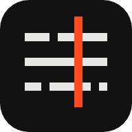
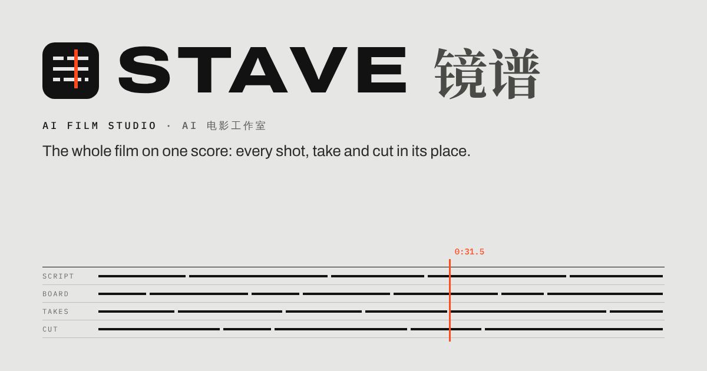

# Kinora Studio 影匣：名字与标志

## 名字

**Kinora Studio**，中文名 **影匣**。描述语：**AI film studio** / **AI 电影工作室**。

Kinora 是 1896 年卢米埃尔兄弟申请专利的家用看片机，1902 年在英国上市，算是最早的家庭影院。
一卷片轮上排着 640 张弯着的照片卡，装在铜芯上；人转动摇柄，卡片一张张翻过；一小片金属“止片”
把转到镜头前的那张卡压平一瞬间，那一瞬就是一帧。一卷大约 30–40 秒。

它和这个工作室一一对得上：

| Kinora | 工作室 |
|---|---|
| 一卷片轮 | 一个镜头（H3 一次生成 5–15 秒） |
| 止片压住的那张卡 | 此刻的那一帧：界面里唯一的红色 |
| 摇柄 | 节奏在你手里：导演写分镜，什么时候开拍、快慢怎么走，你说了算 |
| 家用 | 最早的家庭影院；这个工作室跑在你自己的机器上 |

影匣：装着活动影像的匣子，就是那台机器。

### 为什么是它

在 AI 视频领域没有同名产品，背后有一台真实的机器和一个完整的故事，图标也是从故事里长出来的。
长得像的只有 Kinovi（一个 AI 视频工作室），读起来也有点像 Filmora。

排除过的名字和原因：

| 名字 | 为什么不用 |
|---|---|
| Stave（镜谱） | 第一稿；名字和标志都偏冷，像一个列表图标 |
| Oner | 已有 Oner AI，一个用 MiniMax 模型的 AI 视频工具 |
| Rushes | 已有 RushesLab，给电影人的 AI 镜头生成 |
| 影谱 | 影谱科技，一家做生成式 AI 视频的中国公司 |
| Mise Lab | 一家 AI 制作公司（Mise Creative）的部门 |
| Halation | 一个在本地跑 MiniMax H3 的 AI 视频应用 |
| Kinema | 好几个同名，包括一个开源 AI 视频工具 |
| Xtudio | DNEG 的审片软件 xSTUDIO，和一个叫 Lugh Xtudio 的 AI 剪辑器；口头上和 studio 分不开 |
| Framino | 和 Frameo.ai（AI 视频工作室）只差一个音，frame 开头的名字太多 |
| Tally、Slate、Reel、Kino、Magic Hour、Phi、Lantern、Zoetrope | 太常用，或者已经是别人的名字 |

### 写法

- 句子里写 **Kinora Studio**，第二次出现可以只写 Kinora；中文写 **影匣**。
- 字标是小写的 **kinora**，加粗，i 上的点换成红卡；后面是常规字重的 **Studio**。
- 两个一起出现时写 **Kinora Studio 影匣**（标题、字标旁），句子里写 **Kinora Studio（影匣）**。
- 界面英文里把产品叫 “the Studio” 的地方照旧；中文界面里叫“影匣”。

## 标志

三张圆角卡片拼成一个 K：

- 竖的一张是**片轴**；
- 下面一张**靠着它**；
- 上面红的一张**正翻过止片**：此刻在镜头前的那一帧。

字标里 i 上的点也是这张红卡。红色在图标和字标里只出现这一次。

- **网格**：64 × 64 单位，底板圆角 14。卡片宽 11，圆角 3.5；竖卡 44 高，红卡 27 高、转 36°，下卡 25 高、转 −36°，
  两张斜卡都绕 (27, 32) 转。数字在 `src/brand.ts`。
- **最小尺寸**：带底板 16 px；不带底板 20 px 高。

### 白底和黑底

| 场合 | 图标 | 字 |
|---|---|---|
| 白底、灰卡底（默认） | 墨色底板 `#121212`，卡片 `#E6E6E4` | `kinora` 墨色，字重 800、字距 −0.03em；`Studio` 灰 |
| 黑底（和字标并排、单独的图标、深色模式的 App 图标、黑色浏览器标签） | **抬高一层**的底板 `#1F1F1E`，一圈细边 `#3A3A38`，卡片 `#EDEDEA` | 白用 `#EDEDEA`，不用纯白；字重 760、字距 −0.022em；`Studio` 用 `#8C8C87` |
| 黑底海报、片尾出品标 | 浅色底板 `#EDEDEA` 上的墨色卡片：反白章，平时不用 | — |
| 特别大的展示（片头、海报主视觉） | 也可以去掉底板，卡片直接放在黑底上（`markSvg({ ground: "none" })`） | — |

黑底不是把白底反色：墨色底板会和背景融成一片，所以底板要比背景亮一档、加一圈细边，像浮在上面；亮字在黑底上也显得更粗。红卡在两种底上都不变，
还是 `#FF4B1F`（在 `#121212` 上对比度约 5.6:1）。

界面里：顶栏在灰卡底上用墨色底板的图标；放映页“灯光暗下”时顶栏变黑，自动换成抬高一层的底板，
字重也跟着减一档（`studio.css` 里的 `.st-lightsdown`）。浏览器标签里的 favicon 跟着系统深浅色自动切换。

### 不要

- 不要改红卡的颜色、角度或位置，不要给它加发光；它是唯一的红。
- 不要把字标写成全大写，不要把 i 的点换回圆点，也不要给其他字母加红色。
- 不要在黑底上直接用墨色底板的图标。
- 不要加渐变、阴影、描边，不要拉伸。

## 颜色

| 名字 | 色值 | 用途 |
|---|---|---|
| 墨 | `#121212` | 文字、图标底板 |
| 灰卡 | `#E6E6E4` | 页面底色，墨色底板上的卡片 |
| 纸 | `#F7F7F5` | 卡片、分享图的底 |
| 红 | `#FF4B1F` | 只表示此刻：止片上的那张卡、正在拍、下一步 |
| 夜白 | `#EDEDEA` | 黑底上的字和卡片 |
| 夜板 | `#1F1F1E` + 边 `#3A3A38` | 黑底上的图标底板 |

## 字体

- **Archivo**（可变字重和宽度）：字标、标题和界面。
- **IBM Plex Mono**：时间码、编号、读数。
- **宋体**：剧本正文和中文名“影匣”。

## 文件

| 文件 | 内容 |
|---|---|
| `src/brand.ts` | 名字、颜色、标志的几何、`markSvg()` 和 `faviconSvg()`。改名或改标志只改这里 |
| `src/studio-ui/brand-mark.tsx` | 界面里用的图标（`BrandMark`，`ground` 为 `ink` 或 `night`）和字标（`BrandWord`） |
| `scripts/build-brand-assets.mjs` | 从 `src/brand.ts` 生成 `src/app/icon.svg`、`public/icon-*.png`、`src/app/apple-icon.png` 和 `public/og.png`（`node scripts/build-brand-assets.mjs`，需要 Node 22.18 以上和一个 Chromium） |
| `tests/brand.test.ts` | favicon 和 `src/brand.ts` 一致；三张卡、一张红；界面里没有旧名字 |

## 没有改名的东西

改名只改了看得见的地方。下面这些是部署和数据用的标识，改了会断，所以保留旧名：

- Cloudflare Worker `cinema-studio`、`cinema-studio-cron`，D1 数据库和 R2 桶 `studio`：
  Worker 改名等于新建一个 Worker，原来的密钥和域名不会跟过来。
- RunPod 上的 GPU 机器 `cinema-studio-h3*` 和绘图机 `cinema-studio-painter*`：Studio 靠这些名字认领已有的机器。
- 数据库迁移文件里的注释（已经执行过的迁移不改）。
- `docs/cinema-studio-h3-design.md`：最初复刻 Higgsfield Cinema Studio 的设计稿，保留原文。
- GitHub 仓库名 `open-higgsfield-server`：要改的话在 GitHub 仓库的 Settings → General → Repository name 里改，
  旧地址会自动跳转；改完把 Cloudflare Workers Builds 里连接的仓库确认一下。

导演包的自定义风格目录改成了 `~/.kinora/my-styles`；只有旧目录 `~/.openhiggsfield/my-styles` 存在时仍然读旧目录，不用手动搬。
